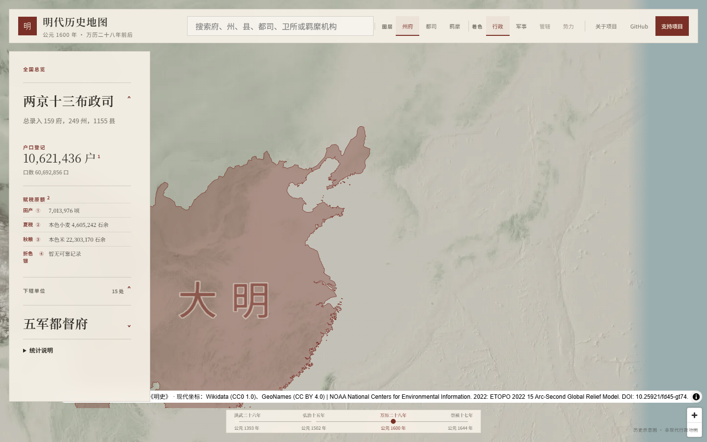
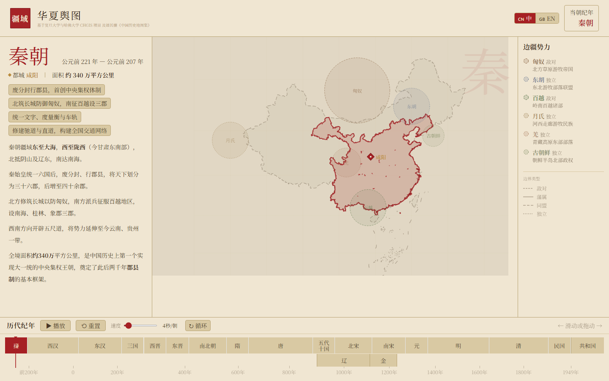
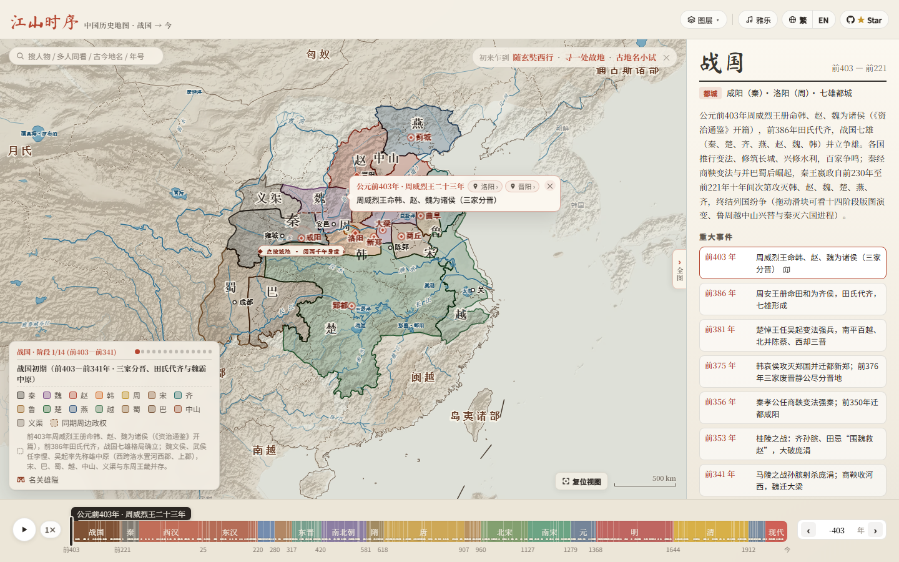
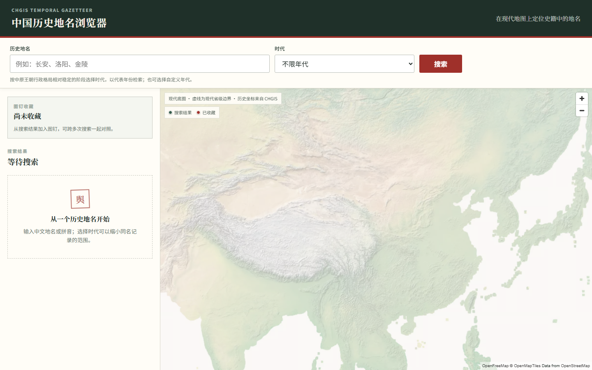
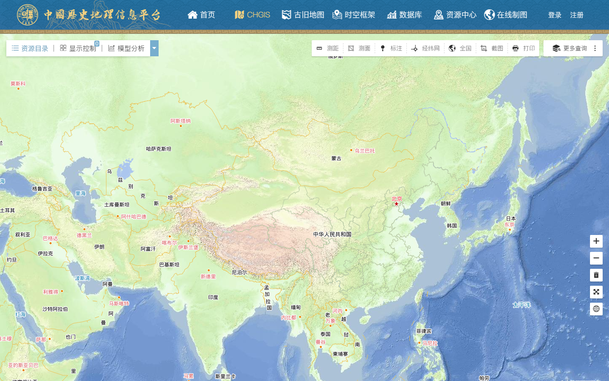
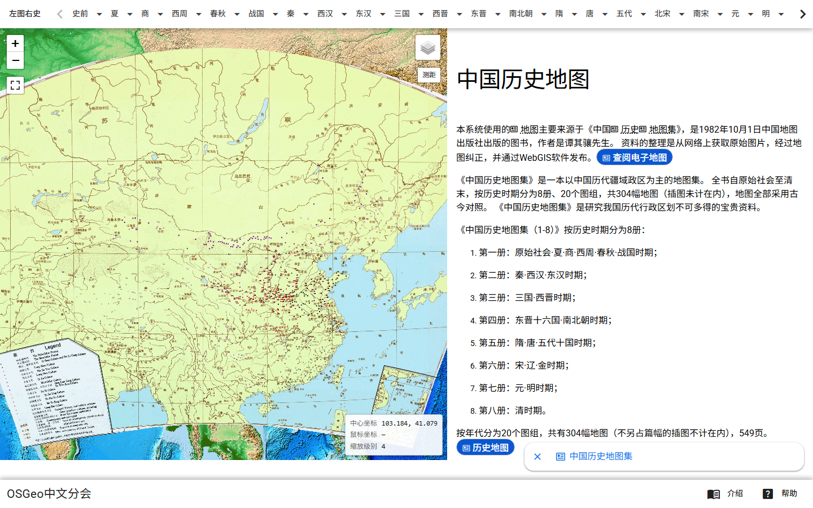

# 中国历代行政区划动态交互网页调研报告

> 调研时间：2026-11-02  
> 调研范围：中文互联网公开可访问的网页、开源项目与学术 GIS 平台  
> 方法：检索 + 实际打开核验 + 截图；需登录、维护中或无法完整加载的站点已单独标注

---

## 一、结论先行

1. **有交互网页，而且数量不少。** 但需要先区分两类东西：一类是“**历代疆域/政权范围**的动态地图”，另一类是“**行政区划（郡、州、府、县）边界与沿革**的交互查询”。网上大多数热门产品属于前者，真正把后者做完整的很少。
2. **“全时段 + 全层级 + 可连续回放 + 可查沿革”四者兼得的公开网页，目前基本没有。** 现有产品通常只占其中两三项：
   - 有的时间跨度很长，但只画疆域轮廓；
   - 有的行政区划层级很细，但只覆盖一个朝代或几个断代；
   - 有的学术数据很权威，但交互体验更像专业 GIS 工具，不适合普通浏览。
3. **最接近你目标的两个代表：**
   - **“历史地图计划 / 大明舆图”**：目前做明代 1600 年，明确到两京十三布政司下的 **159 府、249 州、1155 县**，并包含都司、卫所、羁縻机构，支持府州县搜索和四个明代时间切片。**这是本次调研中最贴近“行政区划变迁”的公开交互网页**，但第一版只覆盖明代。
   - **复旦大学—哈佛 CHGIS**：学术界的“底库”，覆盖公元前 221 年至 1911 年，提供时间序列数据、1820/1911/1990 年断面数据、地名查询与在线制图。它更像“数据基础设施”，不是面向大众的成品应用。
4. **如果目标是做一个应用，不建议从“全历史、全层级”开始。** 更现实的路线是：先选一个朝代、一个断代（例如明万历二十八年，或清嘉庆二十五年），把“府—州—县”的点位、隶属关系和沿革链做扎实，再逐步向时间轴两端扩展。

---

## 二、先厘清概念：什么叫“行政区划变迁”

很多网页看起来“很动态”，但未必满足“行政区划变迁”的需求。建议用四个层次来判断：

| 层次 | 展示内容 | 常见产品 | 是否等于行政区划变迁 |
|---|---|---|---|
| 疆域/政权范围 | 王朝或政权的势力范围、边界轮廓 | 多数“历代疆域演变”视频和网页 | 不完全等于 |
| 政区面 | 郡、州、府、县等行政区的边界 | CHGIS、部分学术 GIS | 最接近 |
| 治所/地名点 | 府治、县治、古城、关隘的位置 | 地名查询、历史地图计划 | 是“点”，不是“面” |
| 沿革关系 | 某地何时改名、隶属谁、拆分合并 | 地名浏览器、沿革数据库 | 是“时间维度”的关键 |

一个真正好用的“行政区划变迁”应用，最好同时具备：**政区面（或至少治所点）+ 层级关系 + 时间轴 + 沿革查询 + 数据来源说明**。目前很少有网页把这五项全部做好。

---

## 三、代表产品对比

> 说明：下表按“本次调研实际访问情况”整理；“行政粒度”一栏区分“疆域面 / 政区面 / 地名点 / 扫描图”。

| 产品 | 类型 | 时间范围 | 行政粒度与内容 | 交互亮点 | 数据来源 / 授权 | 主要局限 |
|---|---|---|---|---|---|---|
| [历史地图计划·大明舆图](https://chronotabula.inkore.ink/) | 科普交互 + 开源 | 明（1393、1502、1600、1644） | 两京十三布政司、159 府、249 州、1155 县；都司、卫所、羁縻机构；点位为主 | 府/州/县搜索、图层切换、时间切片、人口田赋信息 | 项目自建；Wikidata、GeoNames、历史文献等；代码 Apache-2.0，数据为非商业学术/教育许可 | 只覆盖明代；以历史点位为主，不是完整政区面；长期计划尚未完成 |
| [CHGIS（哈佛）](https://chgis.fas.harvard.edu/) / [复旦平台](http://timespace-china.fudan.edu.cn/FDCHGIS/chgis) | 学术 GIS / 数据平台 | 前 221—1911 | 时间序列数据；1820、1911、1990 全国断面；省、府、州、县等层级 | 图层、查询、测量、制图、数据下载 | 哈佛费正清中心 + 复旦史地所；学术免费，禁止商用/转售/再发布 | 专业门槛高；时间序列只覆盖核心省份（内蒙古、青海、新疆、西藏不在时间序列范围）；在线制图/下载需登录；本次 HEAD 偶发 502 |
| [CCTS 中华文明时空基础架构](https://ccts.sinica.edu.tw/) | 学术 WebGIS / WMTS | 先秦—清 | 以谭其骧《中国历史地图集》为底本的历史地图层；含唐、宋、元、明、清等朝代层 | WebGIS 浏览、WMTS 服务、历代疆域/聚落/黄河变迁动画 | 中研院；完整使用需账号申请与授权合约；部分页面显示“系统维护中” | 界面年代较早；主系统维护中；更适合作为底图或学术参考 |
| [华夏舆图](https://atlas.xmiji.com/) | 科普交互 | 先秦—民国（时间轴含近现代） | **疆域面/势力范围为主**，不是政区边界；“细览”只在部分朝代提供详细府界 | 时间轴、播放、断代切换、古今地名检索、城市沿革 | 页面自述基于复旦—哈佛 CHGIS 与谭其骧《中国历史地图集》；未见正式授权声明 | 讲“疆域消长”顺手，但不能当政区边界；不提供源数据下载；商用受限 |
| [舆图](https://geojsoncn.com/cn-historical-atlas/) | 科普交互 | 商周—清末，17 个断代 | 疆域为主；**清朝“细览”确叠府界**，但默认不画逐县政区 | 时间轴、事件、水系、年表、城市沿革、可嵌入网页/课件 | 谭其骧《中国历史地图集》+ CHGIS；另售 SHP/GeoJSON 数据包（仅称学习研究） | 不是完整府县边界库；数据精度为科普级；商用/再发布未明示 |
| [江山时序](https://deanchen.me/jiangshan-map/) | 科普交互 + 开源 | 前 403—今，18 个时期、164 个疆域快照 | 疆域面 + “州道政区”一级政区（示意）+ 古地名点 | 时间轴、事件、诗词路线、点地溯源、古今地名、键盘控制 | 谭其骧 + CHGIS V6 + Hartwell；代码 GPL-3.0，派生数据层仍受学术非商用限制 | 政区为示意性近似；不是严格行政边界数据；适合体验和参考 |
| [时空任意门](https://pessimistcamellia.github.io/china-history-map/) | 开源 Demo | 前 221—2024 | **府级政区面** + 事件点；早期西部数据缺口大 | 点选区划查信息、事件联动、搜索、全球视角 | CHGIS V6 + Hartwell v5 等；代码许可未明确 | 有府级面和联动，但早期数据不全；适合技术参考，不宜直接当权威数据 |
| [中国历史地图 Historiamap](https://www.historiamap.com/) | 半交互地名检索 | 当前：春秋、战国、秦、明 | 府、州、县地名点；春秋 819、战国 645、秦 540、明 4780 个地名 | 时间轴、地名搜索、今地对照、图层 | 据谭其骧《中国历史地图集》矢量化；站点自述 | 朝代覆盖不完整；以地名点为主；政区面不是重点 |
| [中国历史地名浏览器](https://chinese-history-map.vercel.app/) | 地名查询 | 20 个代表年份（秦—清） | 历史地名点位、时代筛选、同名记录区分 | 中文/拼音搜索、时代筛选、图钉收藏、现代地图定位 | CHGIS Temporal Gazetteer；随 CHGIS 学术非商用条款 | 只解决“地名在哪里”，不展示政区边界和沿革链 |
| [中华历史时空沙盘](https://www.shaqi.com/) | 科普/3D 沙盘 | 前 2070—2025 | 疆域、政权范围、历史事件；强调地形与时间轴 | 时间轴、图层、事件分类、地形沙盘 | 站点自建，来源与授权不透明 | 更偏“历史事件沙盘”；行政区划层级不是重点；依赖 JS/账号，本次未完整验证 |
| [全历史·时空地图](https://www.allhistory.com/map) | 通识/商业平台 | 全球、古今 | 世界历史地图、事件、人物、知识图谱；**非中国历代政区界** | 时间轴、地图、人物/事件关联 | 商业平台，版权归平台；部分功能需登录 | 中国行政区划粒度浅；适合通识，不是专业工具；本次正文未完整验证 |
| [OSGeo 左图右史](https://history-map.osgeo.cn/) | 静态扫描 WebGIS | 原始社会—清 | 谭其骧《中国历史地图集》304 幅地图的扫描/纠正图 | 缩放、图层、按朝代浏览 | 谭其骧《中国历史地图集》扫描图 | 本质是“可缩放的扫描地图”，不是矢量化、可查询的政区数据库 |
| [历史地图网](http://www.txlzp.com/lishi/) / [地图集](https://www.dituji.com/lsdt/zglsdtj/) | 静态图片站 | 历代 | 高清扫描图、按朝代整理 | 翻页、看图 | 网络整理，来源与版权参差 | 只能看，不能查、不能联动 |

---

## 四、分项点评

### 1. 最接近“行政区划变迁”的公开交互网页：历史地图计划 / 大明舆图

这是本次调研中最值得注意的新项目。它没有停留在“画一个明朝大轮廓”，而是把明代行政层级拆开：

- 全国总览：**两京十三布政司**；
- 政区统计：**159 府、249 州、1155 县**；
- 另有都司、行都司、留守司、卫所等军事体系，以及宣慰、土司、羁縻等特殊治理单位；
- 支持按“府、州、县、都司、卫所、羁縻机构”搜索；
- 以 **1393、1502、1600、1644** 四个时间节点展示明代变化；
- 叠加人口、田土、赋税等历史信息；
- 代码 Apache-2.0，数据为非商业学术/教育许可。

它的价值在于：**第一次把“府州县层级”做得像一张可查询的现代交互地图，而不是一张静态示意图。**  
它的局限也很明确：**第一版只做明代，且以历史点位为主，不是完整政区面；长期计划中的两宋、五代、唐代尚未完成。** 如果你的目标只是“先做一个能看的 MVP”，它是目前最好的参照物。



### 2. 最适合“看疆域怎么变”的科普网页：华夏舆图、舆图、江山时序

这三者视觉完成度最高，适合课堂演示、内容创作和快速建立感性认识。

- **[华夏舆图](https://atlas.xmiji.com/)**：从先秦到民国/近现代，时间轴 + 播放 + 断代切换 + 城市沿革。它的“细览”只在部分朝代提供详细府界，本质上仍是“疆域为主、政区为辅”。
- **[舆图](https://geojsoncn.com/cn-historical-atlas/)**：商周至清末，17 个断代，事件、水系、年表、城市沿革都做得比较完整，还支持把当前朝代地图**嵌入网页、课件或公众号**，对教学很友好。清朝的“细览”确实叠加府界，但默认层仍以疆域为主。
- **[江山时序](https://deanchen.me/jiangshan-map/)**：18 个时期、164 个疆域快照，有“州道政区”示意图层、古地名、关河丝路、诗词路线和重大事件。它的优势是“历史叙事 + 地图”结合得好，且 GitHub 开源（代码 GPL-3.0），适合作为产品交互参考；但派生数据层仍受 CHGIS/Hartwell 学术非商用限制。





**共同短板：** 它们主要回答“王朝的疆域怎么变”，而不是“某个府的边界怎么变、某个县什么时候被撤销、什么时候划归另一个府”。如果你要的是后者，需要继续看下面的地名/政区工具。

### 3. 查“某地历代属什么政区”：中国历史地名浏览器、Historiamap

- **[中国历史地名浏览器](https://chinese-history-map.vercel.app/)**：基于 CHGIS Temporal Gazetteer，提供 20 个代表年份（秦、西汉、东汉、曹魏、西晋、北魏、隋、唐、北宋、金、元、明、清等），可以输入中文地名或拼音，按时代筛选同名记录，并把结果钉在现代地图上。它解决的是“**这个古地名在哪里、属于哪个时代**”，不是“画出政区边界”。
- **[中国历史地图 Historiamap](https://www.historiamap.com/)**：当前可看春秋、战国、秦、明，支持府州县地名搜索和今地对照。明代有 4780 个地名，适合做地名定位；但朝代覆盖还不完整，且以地名点为主。



### 4. 学术底座：CHGIS、复旦平台、CCTS

如果你要做研究、二次开发或需要可靠的数据来源，这三个是绕不开的。

- **[CHGIS（哈佛官网）](https://chgis.fas.harvard.edu/)**：项目 2001 年启动，覆盖公元前 221 年至 1911 年，提供时间序列数据、1820/1911/1990 年断面数据、地名查询 API 和样品地图。**V6 数据发布于 2016 年**。授权为学术免费，禁止商业使用、转售或再发布。
- **[复旦大学中国历史地理信息平台](http://timespace-china.fudan.edu.cn/FDCHGIS/chgis)**：CHGIS 的中方平台，提供 CHGIS、古旧地图、时空框架、数据库、资源中心、在线制图等模块。页面可直接浏览；在线制图/数据下载需登录，本次 GET 返回 200，但 HEAD 偶发 502，遇到波动可重试。
- **[CCTS 中华文明时空基础架构](https://ccts.sinica.edu.tw/)**：中研院以谭其骧《中国历史地图集》为基础构建的 WebGIS，提供历代历史地图层和 WMTS 服务，还保留“历代疆域变迁”“历代聚落变迁”“历代黄河变迁”等动画入口。主系统部分功能显示“系统维护中”，完整使用需账号申请与授权合约；WMTS 仍可用于接入自己的地图应用。



**重要提醒：** CHGIS 的时间序列主要覆盖所谓“核心省份”，**内蒙古、青海、新疆、西藏不在时间序列范围内**（1911 年断面层可能包含）。这意味着“全国所有朝代、所有县”的连续边界数据，在公开学术数据里也不完整。做产品时必须正视这个缺口，不能假装数据是全覆盖的。

### 5. 想看“原版谭图”：OSGeo 左图右史

[OSGeo 左图右史](https://history-map.osgeo.cn/) 把《中国历史地图集》的 304 幅地图扫描、纠正后放到 WebGIS 上，可以缩放、切换朝代。它的价值是“**最接近原书**”，适合核对具体图幅和地名；但它不是矢量化数据库，不能按行政区划做查询、统计和沿革分析。



---

## 五、关键发现：为什么“看起来很全”，实际却不够用

### 发现 1：大多数产品做的是“疆域”，不是“行政区划”

“疆域”只需要一个或几个政权外轮廓；“行政区划”需要省—府—州—县多级面、治所点、隶属关系、撤并改隶记录。后者的数据量、历史考证难度和版权风险都高一个数量级。因此，市场上“疆域动画”远多于“政区边界库”。

### 发现 2：时间连续性和空间完整性不可兼得

- CHGIS 的时间序列覆盖核心省份，边疆省份缺失；
- 1820、1911 有全国断面，但只有两个“切片”，不是逐年连续；
- 科普站点为了视觉流畅，往往把政区简化成示意边界或只保留点位；
- 地名查询工具能查“点”，但不能画“面”。

### 发现 3：学术平台和大众产品之间有明显断层

学术平台（CHGIS、CCTS、复旦平台）数据可靠，但界面专业、学习成本高；大众产品（华夏舆图、舆图、江山时序）体验好，但数据来源和精度往往只到“科普参考”级别。**目前缺少一个既严谨又好用的中间态产品。**

### 发现 4：历史边界本身有争议，不能当成现代边界

历史时期的疆域和政区边界，很多是势力范围、羁縻关系、封贡关系，并非现代意义上的精确界线。所有严肃的产品都会加免责声明。你做应用时，必须明确“历史示意、非现实主张”，并避免把历史疆域图用作现代行政或主权表达。

### 发现 5：版权和地图合规是硬约束

- 谭其骧《中国历史地图集》的图形和数字化成果有版权，不能随意商用；
- CHGIS 数据明确禁止商业使用、转售和再发布；
- 历史地图计划的数据是非商业学术/教育许可；
- 在中国大陆公开上线地图类产品，还需要关注地图审核、底图合规和边界表述规范，避免“问题地图”。

---

## 六、按使用场景的选型建议

| 你的需求 | 推荐入口 | 理由 |
|---|---|---|
| 快速感受“两千年疆域怎么变” | [华夏舆图](https://atlas.xmiji.com/)、[舆图](https://geojsoncn.com/cn-historical-atlas/)、[江山时序](https://deanchen.me/jiangshan-map/) | 视觉好、时间轴顺、适合演示 |
| 查某个古地名今天在哪、历代属哪 | [中国历史地名浏览器](https://chinese-history-map.vercel.app/)、[Historiamap](https://www.historiamap.com/) | 地名检索和时代筛选成熟 |
| 看明代府州县完整层级 | [历史地图计划·大明舆图](https://chronotabula.inkore.ink/) | 159 府、249 州、1155 县，目前最细 |
| 做研究、写论文、需要 GIS 数据 | [CHGIS](https://chgis.fas.harvard.edu/)、[复旦平台](http://timespace-china.fudan.edu.cn/FDCHGIS/chgis) | 学术权威、可下载、可引用 |
| 需要历史地图底图/瓦片服务 | [CCTS WMTS](https://gis.sinica.edu.tw/ccts/) | 可直接接入 QGIS/ArcGIS/OpenLayers |
| 看原版谭图、核对图幅 | [OSGeo 左图右史](https://history-map.osgeo.cn/) | 304 幅扫描图，最接近原书 |
| 想参考代码自己做 | [江山时序 GitHub](https://github.com/DeanChensj/jiangshan-map)、[历史地图计划 GitHub](https://github.com/cytia/historical-map-project)、[heyyybingo/china-historical-atlas](https://github.com/heyyybingo/china-historical-atlas) | 有完整前端实现和数据结构可参考 |

---

## 七、如果要做类似应用：建议的技术与产品路线

### 1. 先定“最小可用范围”，不要一上来做全史

建议按以下顺序推进：

- **v0：单朝代高精度**  
  选明代 1600 或清代 1820。前者有“历史地图计划”的府州县点位可参考，后者有 CHGIS 的全国断面数据。先把“府—州—县”三级关系、治所点位、搜索和详情卡做出来。
- **v1：加时间切片**  
  明代做 1393/1502/1600/1644；清代做 1820/1911。让用户能拖动时间轴看同一地区隶属关系的变化。
- **v2：加政区面**  
  在点位基础上，逐步补充府界、州界、县界；可用 CHGIS 的边界数据或对谭图进行矢量化。注意：这是最耗人力的一步。
- **v3：向两端扩展**  
  优先两宋、唐、汉；早期（先秦）数据稀疏，适合做“示意 + 事件”，不宜承诺精确边界。

### 2. 数据模型建议

每一个历史政区实体至少包含：

```text
feature_id        唯一标识
name              名称（含异名、别名）
level             层级（省/府/州/县/卫所/羁縻）
parent_id         上级政区
valid_from        起始年（含不确定性）
valid_to          终止年（含不确定性）
geometry          点 / 线 / 面（GeoJSON）
seat_point        治所坐标
source            出处（谭图页码、CHGIS ID、方志卷次）
confidence        置信度（精确/大致/待考）
notes             沿革说明、争议说明
```

关键点：**不要把“名称”当主键**。历史地名会重复、会迁移、会改名，必须用稳定的实体 ID + 时间区间来表达。

### 3. 技术栈建议

- 地图渲染：**MapLibre GL JS**（开源、矢量瓦片友好）或 Leaflet（轻量）；
- 大数据量面图层：**deck.gl** + **PMTiles** / 矢量瓦片；
- 空间数据库：**PostGIS**；
- 时间轴：自研 React/Vue 组件，或参考江山时序的交互；
- 搜索：Elasticsearch/Meilisearch + 拼音/别名索引；
- 部署：纯静态 + 对象存储即可做科普版；有后台编辑需求再上服务端。

### 4. 产品功能优先级

**必须有：**
- 时间轴/年份选择；
- 地图缩放、平移、图层开关；
- 点击政区/点位弹出详情（名称、年代、隶属、今地、出处）；
- 搜索（古今地名、拼音、别名）；
- 数据来源与免责声明。

**加分项：**
- 同一地点“历代沿革链”（从秦到清一键展开）；
- 两个年份对比（左右分屏或滑动对比）；
- 事件图层；
- 导出图片/分享链接；
- 教学模式（预设问题、课堂演示）。

### 5. 合规与版权

- 历史底图尽量使用已授权或自绘底图；
- 谭图、CHGIS、历史地图计划的数据使用前逐项确认许可；
- 公开上线前做地图审核与边界表述审查；
- 页面显著位置标注“历史示意、非现实主张、仅供参考”。

---

## 八、最终推荐

### 如果你只是“想看”：

**首选组合：华夏舆图（看疆域）+ 中国历史地名浏览器（查地名）+ 历史地图计划（看明代府州县层级）。**

### 如果你要“做研究/做产品”：

**首选底座：CHGIS + 复旦平台；交互参考：江山时序；数据参考：历史地图计划；底图补充：CCTS WMTS。**

### 如果你要“做一个自己的应用”：

**建议从“明代 1600”或“清代 1820”单断代 MVP 开始，先做点位和沿革查询，再逐步补政区面。**  
这比一开始承诺“从秦到清、所有县、逐年变化”更可行，也更容易做出质量。

---

## 附录 A：本次实际截图核验的站点

- [华夏舆图](https://atlas.xmiji.com/)
- [舆图](https://geojsoncn.com/cn-historical-atlas/)
- [江山时序](https://deanchen.me/jiangshan-map/)
- [历史地图计划·大明舆图](https://chronotabula.inkore.ink/)
- [中国历史地图 Historiamap](https://www.historiamap.com/)
- [中国历史地名浏览器](https://chinese-history-map.vercel.app/)
- [复旦大学中国历史地理信息平台](http://timespace-china.fudan.edu.cn/FDCHGIS/chgis)
- [CCTS](https://ccts.sinica.edu.tw/)
- [OSGeo 左图右史](https://history-map.osgeo.cn/)

## 附录 B：开源项目与数据源

| 项目 | 内容 | 授权/可用性 | 入口 |
|---|---|---|---|
| 历史地图计划 | 明代府州县点位、四时间切片、开源前端 | 代码 Apache-2.0；数据非商业学术/教育许可 | https://github.com/cytia/historical-map-project |
| 江山时序 | 18 时期、164 疆域快照、州道政区示意层、事件/诗词路线 | 代码 GPL-3.0；CHGIS/Hartwell 派生层仍学术非商用 | https://github.com/DeanChensj/jiangshan-map |
| 时空任意门（pessimistcamellia） | 秦至 2024 的府级政区面 + 事件联动 demo | 代码许可未明确；早期西部数据缺口大 | https://github.com/pessimistcamellia/china-history-map |
| heyyybingo/china-historical-atlas | 夏商周至清，72 个时期，仅疆域面 | **未见 LICENSE**；无政区界，谨慎参考 | https://github.com/heyyybingo/china-historical-atlas |
| CHGIS V6 | 时间序列 + 1820/1911/1990 断面数据 | 仅学术、非商用、禁转售/再发布 | https://chgis.fas.harvard.edu/data/chgis/v6/ |
| gb2260 | 现代行政区划代码历史沿革（1949—2025） | CC0-1.0（须遵守上游）；无几何边界 | https://github.com/xihan123/gb2260 |
| Gitee AdministrativeDivision | 宣称“春秋至近现代政区边界/GeoJSON” | **本次核验仓库近乎空壳：仅 README 模板、2 次提交、未声明许可证，暂不可用** | https://gitee.com/AdministrativeDivision/administrative-division |

> 注：以上链接与功能以 2026-11-02 访问情况为准；部分站点可能随时调整、登录或下线。  
> 详细逐站核验记录见：[来源审计附录](research/source_audit.md)。
